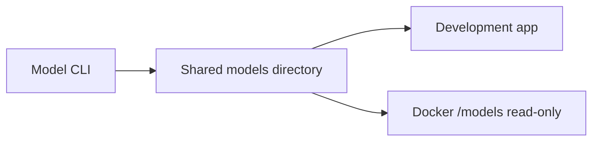

<p align="center">
  
</p>

<h1 align="center">RedenCut</h1>

<p align="center">
  <strong>Edit your podcast through its transcript.</strong><br />
  A local-first audio editor with text-based cuts, a multitrack timeline, and on-device speech analysis.
</p>

<p align="center">
  <a href="#features">Features</a> ·
  <a href="#getting-started">Getting started</a> ·
  <a href="#local-speech-analysis">Speech analysis</a> ·
  <a href="#development">Development</a>
</p>

<p align="center">English</p>

> **Development preview:** RedenCut is under active development and currently focuses on macOS.

## What is RedenCut?

RedenCut is a 100% free audio editor specifically designed for podcast editing flows.

It combines the audio editing tools you need with local AI that turns recordings into text on your computer, so you can edit conversations by selecting words.


## Features

- **Transcribe locally.** Turn recordings into text with local AI that automatically detects different speakers and labels their parts of the conversation.
- **Edit audio like a document.** Shape your conversation directly in the transcript, using familiar text selections and editing shortcuts.
- **Organize speakers.** Give speakers names and colors, group them, and filter the transcript to focus on a particular person.
- **Refine cuts visually.** Adjust where a cut starts and ends on the waveform, bring back audio you’ve cut, and listen to how the edited conversation flows.
- **Arrange multiple tracks.** Split, trim, move, and duplicate clips. Move several clips together and line them up across tracks.
- **Balance your mix.** Adjust each track’s volume, mute tracks or listen to one on its own, and use Auto Level to balance voice levels.
- **Save and continue later.** Save your edits and transcripts in a project, then reopen it to pick up where you left off.
- **Sync editing progress with your team.** Edits and transcripts are stored in readable text files, so teammates can use version control tools like Git to track changes and share progress.
- **Export your podcast.** Save your finished mix as MP3, WAV, FLAC, or AAC, with your cuts and volume adjustments applied.
- **Make the editor yours.** Choose a light or dark theme, switch between English and Simplified Chinese, and arrange the transcript and audio panels to suit how you work.

### Supported audio formats

| Operation | Formats |
| --- | --- |
| Import | WAV, MP3, FLAC, AAC, M4A, OGG, AIFF |
| Export | MP3, WAV, FLAC, AAC |

## Getting started

### Availability

Development currently focuses on macOS.
Running the desktop app on Windows or Linux is not actively tested.
Download the latest DMG from the project's GitHub Releases page.

### Run from source on macOS

Prerequisites:

- Git and Node.js **24.14.0**, the version pinned in `package.json`, with npm.
- Apple command-line developer tools, CMake, Ninja and pkg-config for the initial native runtime build.
- Internet access and disk space for the pinned source archives and Python dependencies.
- The managed runtime currently targets macOS ARM64; Windows and Intel macOS are not certified by this recipe.

```sh
git clone https://github.com/boningdong/RedenCut.git
cd RedenCut
npm ci

# Prepare native tools and Python dependencies, then the default speech models.
npm run setup:runtime
npm run check:runtime
npm run setup:models
npm run check:models

# Start the desktop app.
npm run dev
```

`setup:runtime` installs the native audio/speech tools and Python dependencies; it does not download model weights.
`setup:models` installs the default model set: Small Whisper, English and Chinese alignment, and speaker diarization.
The app, model CLI and Docker harness share one model directory, so existing verified installations are reused.
You can skip speech preparation during onboarding and use waveform and multitrack editing, then prepare resources later through **Settings → Models & dependencies**.
Settings can download Whisper and alignment models after the runtime is ready; development diarization is acquired through the model CLI.
Release builds bundle diarization and expose the speaker-recognition switch without an account prompt.

See [speech models and dependencies](docs/speech-models-and-dependencies.md) for managed runtime, model caches, and setup details.
The app never falls back to a system/Homebrew FFmpeg, an npm static binary, or an unrelated Python environment; a missing or invalid managed runtime produces a setup error.

### Your first edit

1. Create a project and import audio through the file picker.
2. Generate a transcript for a track, or for all tracks, once speech resources are ready.
3. Click a word to hear its position, then select unwanted text and press **M** or **Delete** to redact it.
4. Use **Preview Mode** (on by default) to audition the cuts, and adjust their boundaries on the waveform.
5. Arrange clips and tracks, save the project, and export your audio.

**Redaction and mute have different effects.**
Redactions remove selected passages from the export and can be skipped during preview.
Clip and track mute control audibility; ordinary muted regions and natural gaps retain their timeline placement.
Export applies redactions even when **Preview Mode** is off.

For a portable project, use managed copies of the source audio.
Projects that reference external files still need those files to remain available.

## Local speech analysis

| Stage | Engine | Purpose |
| --- | --- | --- |
| Transcription | whisper.cpp | Produce the transcript from your recording |
| Word alignment | WhisperX with pinned alignment models | Match transcript words to audio timestamps |
| Optional speaker separation | pyannote.audio | Assign anonymous speaker labels to speech |

The current alignment models cover **English and Chinese**.
The multilingual transcription model does not imply full editing-pipeline support for every language; broader language support and mixed-language quality still need validation.
Speaker separation provides editable anonymous labels, not identification of real-world people.

### Downloads and privacy

Audio decoding, transcription, alignment, speaker analysis, and export run locally.
Once the required runtimes and models are installed, normal speech inference uses offline model loading and does not need a cloud transcription service.
Initial dependency installation and model downloads require internet access.

Hugging Face access is needed only when acquiring gated model files, including development diarization.
Accept the model's conditions with your own account, then use `hf auth login`, `HF_TOKEN_PATH`, or `HF_TOKEN` for the model CLI.
Credentials are never passed to inference workers, saved in installations, or requested in Settings or onboarding.
Already verified models are reused without authentication; packaged users receive the bundled diarization model.

### Shared models directory

| Command | Resources prepared or checked |
| --- | --- |
| `npm run setup:runtime` | Native tools and Python dependencies only |
| `npm run setup:models` | Default: Small Whisper, English/Chinese alignment, diarization |
| `npm run setup:models -- --set text` | Small Whisper and English/Chinese alignment |
| `npm run setup:models -- --model ID` | One manifest-listed model |
| `npm run check:models` | Offline integrity check of the default set; no downloads |

Choose a directory with `--models-path PATH`, then `REDENCUT_MODELS_PATH`, otherwise the platform's RedenCut application models directory.
On macOS the default is `~/Library/Application Support/RedenCut/models`; each model lives under `<capability>/<id>/<revision>/` with `installation.json` and verified files.
The same override works with `npm run dev -- --models-path PATH`, `setup:models`, `check:models`, `package:mac`, `release:prepare`, and the Docker harness.
An override applies to that invocation and does not change saved app preferences.



To reuse an older model directory, run `npm run setup:models -- --import-from OLD_ROOT`.
The CLI imports and validates matching manifest revisions into the shared layout; use `--model ID` when importing an individual model's directory.
Release preparation copies verified diarization into `Resources/models/diarization/<id>/<revision>/`, separate from `Resources/runtime/`; downloadable Whisper and alignment models remain in the application model library.

Model revisions, dependencies, access requirements, and environment details are recorded in [speech models and dependencies](docs/speech-models-and-dependencies.md) and the [model manifest](speech-worker/models.json).

## Keyboard shortcuts

| Shortcut | Action |
| --- | --- |
| Space | Play or pause |
| S | Split the selected clip at the playhead |
| M | Mute selected clips or redact a waveform/text selection |
| Delete / Backspace | Remove the selected clip or redaction overlay; redact a range/text selection |
| ⌘S | Save project |
| ⌘Z / ⌘⇧Z | Undo / redo |
| ⌘C / ⌘X / ⌘V | Copy / cut / paste clips when Audio has focus |
| ⌘D | Duplicate selected clips |
| ← / → | Seek backward / forward one second |
| ⇧← / ⇧→ | Seek backward / forward five seconds |

Shortcuts depend on focus and selection.
See the [full keyboard reference](docs/key-mappings.md) for editing contexts, track routing, and boundary adjustments.

## Development

RedenCut uses **Electron, React, TypeScript, and Zustand**, with FFmpeg for audio processing and a separate Python worker for alignment and speaker analysis.

| Directory | Responsibility |
| --- | --- |
| `src/main/` | Native dialogs, projects, audio processing, speech jobs, and managed resources |
| `src/preload/` | Narrow bridge between Electron and the renderer |
| `src/renderer/` | Editor UI, timeline interaction, and audio playback |
| `src/shared/` | Shared types, schemas, and IPC contracts |
| `speech-worker/` | Python speech worker, locked dependencies, and model manifest |
| `e2e/` and `harness/` | End-to-end scenarios and the Docker-based test harness |

```sh
# Everyday development
npm run dev           # Start development
npm run build         # Build the app code (not a distributable installer)
npm run preview       # Preview the built app

# Verification
npm test              # Run unit tests
npm run typecheck     # Check TypeScript
npm run check         # Formatting, lint, dead-code checks, types, tests, and build

# Performance investigation
npm run profile:timeline # Timeline history retention/comparison benchmark
npm run profile:waveform # Waveform interaction benchmark
```

Scripts in `package.json` are grouped in the following order.
Blank lines separate the groups; the package-specific Prettier configuration preserves them.
They are developer commands, not commands required by installed-app users.
JSON does not support comments, so the group descriptions live here.

| Group | Audience and purpose | Scripts |
| --- | --- | --- |
| Development | Public developer entrypoints | `dev`, `build`, `preview` |
| Resources | Public setup and installed-resource validation | `setup:runtime`, `setup:models`, `check:runtime`, `check:models` |
| Verification | Public checks and unit-test iteration | `check`, `format`, `format:check`, `lint`, `deadcode`, `typecheck`, `test`, `test:watch` |
| Focused tests | Components of `check`; also callable for diagnosis | `test:runtime`, `test:models`, `test:release`, `test:tooling` |
| Performance | Developer benchmarks | `profile:timeline`, `profile:waveform` |
| Maintenance | Explicit local-data cleanup; exit the app first | `clear:onboarding`, `clear:models` |
| Distribution | Maintainer packaging and release entrypoints | `package:mac`, `release:prepare`, `release:draft` |
| Helpers | Lower-level runtime building/staging and direct MCP server entry; normal setup, packaging and Docker entrypoints are preferred | `runtime:build`, `runtime:stage`, `harness:mcp` |
| Harness runners | Container test runners; use the Docker wrapper | `test:harness`, `test:harness:faults`, `test:harness:all` |
| Product E2E runners | Container test runners; use the Docker wrapper | `test:e2e:base`, `test:e2e:speech`, `test:e2e:all` |

See [architecture](docs/architecture-standards.md), [coding standards](docs/coding-standards.md), and the [test harness guide](harness/container/README.md) for more detail.
The scripts in [package.json](package.json) are the source of truth for development commands.
The timeline benchmark measures history retention and edit comparison, not end-to-end UI latency; see the [CoW performance report](docs/superpowers/reports/2026-09-27-timeline-cow.md).

## Local macOS package

On Apple Silicon, run `npm run package:mac` after preparing the managed runtime with `npm run setup:runtime` and models with `npm run setup:models`.
This produces an ad-hoc-signed, unnotarized DMG for manual installation; automatic updates are not included.
See [macOS packaging](docs/macos-packaging.md) for prerequisites, output paths, signing limitations and validation.
For tag-triggered GitHub Actions builds and draft publication, see [GitHub Releases](docs/github-releases.md).

## Current limitations

RedenCut is under active development.
The current implementation includes the editing and speech features described above, but release readiness and speech quality across representative recordings remain ongoing work.

## Contributing

RedenCut is currently maintained primarily by its main author.
Feature requests and bug reports are welcome through [Issues](https://github.com/boningdong/RedenCut/issues).

## Bug Report
To report a problem:

1. Search [open and closed issues](https://github.com/boningdong/RedenCut/issues?q=is%3Aissue) using what you were doing, what went wrong, or the error shown (for example, “import audio hangs” or “export silent”). You do not need to know the feature name. Diagnostic IDs are unique to an occurrence, so use the error text or code when searching for similar problems.
2. If you can reproduce it, collect diagnostics soon afterward: open **Help → Collect diagnostics…** or **Settings → Diagnostics**, then choose **Collect diagnostics** at the bottom. Both entries open the same Settings page, and this also works without an error message.
3. Choose **Review files**, review them, then **Save bundle…** to save a ZIP. It contains retained application events, main/helper messages and environment details; older logs may have rotated away. Audio, transcripts and project files are not included. Common secrets and private paths are redacted, but third-party logs can still contain personal information: review before sharing. Nothing is uploaded automatically.
4. Open a new issue using **Bug report**. Give it a plain title describing the action and symptom, such as “Importing an MP3 stops at 50%”. Describe the steps, what happened, what you expected, and the app/OS versions.
5. Optionally drag the ZIP and relevant screenshots into the attachment field, wait for GitHub's upload to finish, then submit. If diagnostics are unavailable, report the problem without them. If a similar issue exists, add useful new steps or an attachment there instead of opening a duplicate.
If an audio sample is needed, use a short recording you have permission to share.

We are not accepting large pull requests at this time.
If you would like to contribute, please contact the author by email before starting work so we can discuss the scope and direction.
We are still exploring how community contributions should work, and the contribution process will evolve as the project grows.

## Acknowledgments

RedenCut is built on Electron, React, FFmpeg, whisper.cpp, WhisperX, pyannote.audio, and the models listed in the speech manifest.
Their respective licenses and model access conditions apply independently.

## License

RedenCut original project code is licensed under the **Apache License 2.0 (Apache-2.0)**.
See [LICENSE](LICENSE) for the full license text.
Third-party dependencies and models remain subject to their respective licenses and access conditions.
