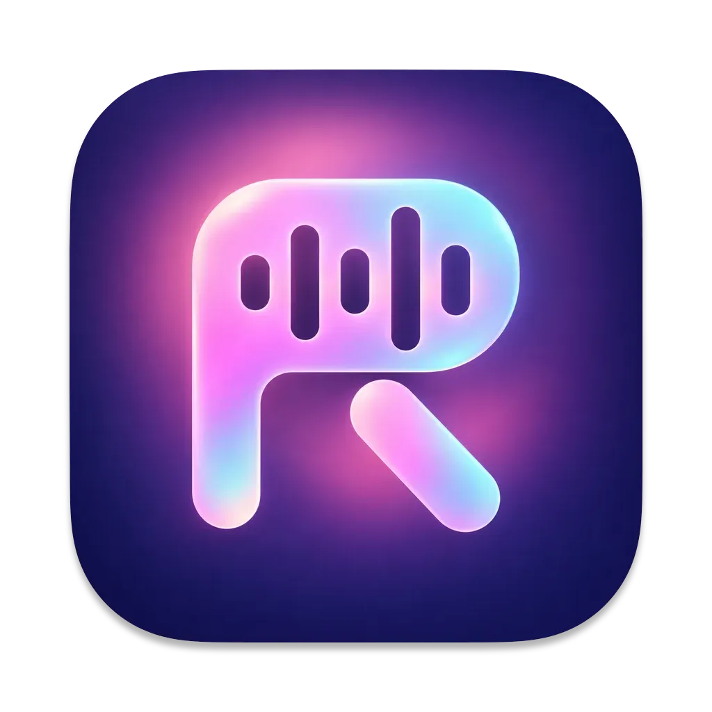
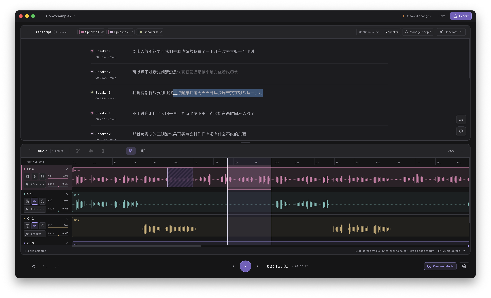

<p align="center">
  
</p>

<h1 align="center">RedenCut</h1>

<p align="center">
  <strong>Edit your podcast through its transcript.</strong><br />
  A local-first audio editor with text-based cuts, a multitrack timeline, and on-device speech analysis.
</p>

<p align="center">
  <a href="#features">Features</a> ·
  <a href="#getting-started">Getting started</a> ·
  <a href="#development">Development</a> ·
  <a href="#help-and-feedback">Bug Report</a>
</p>
> **Development preview:** RedenCut is under active development and currently focuses on macOS.

## What is RedenCut?

RedenCut is a 100% free audio editor specifically designed for podcast editing flows.

It combines the audio editing tools you need with local AI that turns recordings into text on your computer, so you can edit conversations by selecting words.



## Features

- **Transcribe locally.** Turn recordings into text with local AI that automatically detects different speakers and labels their parts of the conversation. Transcript-based audio editing currently supports **English and Chinese**.
- **Edit audio like a document.** Shape your conversation directly in the transcript, using familiar text selections and editing shortcuts.
- **Organize speakers.** Give speakers names and colors, group them, and filter the transcript to focus on a particular person.
- **Refine cuts visually.** Adjust where a cut starts and ends on the waveform, bring back audio you’ve cut, and listen to how the edited conversation flows.
- **Arrange multiple tracks.** Split, trim, move, and duplicate clips. Move several clips together and line them up across tracks.
- **Balance your mix.** Adjust each track’s volume, mute tracks or listen to one on its own, and use Auto Level to balance voice levels.
- **Save and continue later.** Save your edits and transcripts in a project, then reopen it to pick up where you left off.
- **Sync editing progress with your team.** Edits and transcripts are stored in readable text files, so teammates can use version control tools like Git to track changes and share progress.
- **Export your podcast.** Save your finished mix as MP3, WAV, FLAC, or AAC, with your cuts and volume adjustments applied.
- **Make the editor yours.** Choose a light or dark theme, switch between English and Simplified Chinese, and arrange the transcript and audio panels to suit how you work.

### Supported audio formats

| Operation | Formats |
| --- | --- |
| Import | WAV, MP3, FLAC, AAC, M4A, OGG, AIFF |
| Export | MP3, WAV, FLAC, AAC |

## Getting started

### Availability and download

Development currently focuses on macOS.
Running the desktop app on Windows or Linux is not actively tested.

Download the latest DMG from the project's GitHub Releases page.

### Your first edit

1. Import your recordings into a project.
2. Generate a transcript for one track or all tracks.
3. Select unwanted text to "redact" the audio, then listen back and refine the "redact".
4. Arrange your tracks, save the project, and export your podcast.

Prepare speech features in **Settings → Models & dependencies** before generating a transcript.
You can skip speech preparation and use waveform and multitrack editing right away.
For editing controls and shortcuts, see the [keyboard and editing reference](docs/key-mappings.md).

### Saving and sharing projects

- **Copy and share your project.** Imported recordings, transcripts, and saved edits are kept together in your `.redencut` project. Copy the project to back up or share your work.
- **Track changes with Git.** Edits and transcripts are stored as readable text files, so version control tools can track changes and sync editing progress with your team.
- **Recover missing recordings.** If audio is missing when you open a project, RedenCut guides you to find the original files.

### Speech and privacy

Transcription, speaker detection, audio editing, and export all run locally on your computer.
Initial speech-model downloads require internet access; once prepared, speech processing works offline.

## Development

This section is for developers who want to build, run, or contribute to RedenCut.

### Setup on macOS

#### Prerequisites

- `git` and `node.js 24.14.0`, the version pinned in `package.json`, with `npm`.
- Apple command-line developer tools, CMake, Ninja and pkg-config for the initial native runtime build.
- Internet access and disk space for the pinned source archives and Python dependencies.
- The managed runtime currently targets macOS ARM64; Windows and Intel macOS are not certified by this recipe.

#### Setup commands

```sh
git clone https://github.com/boningdong/RedenCut.git
cd RedenCut
npm ci

# Prepare native tools and Python dependencies, then the default speech models.
npm run setup:runtime
npm run check:runtime
npm run setup:models
npm run check:models

# Start the desktop app.
npm run dev
```

`setup:runtime` prepares the native tools and Python dependencies needed for speech processing.
Once the runtime is ready, there are two ways to prepare models:

**Command line — install the default set before launching the app**

1. Run `npm run setup:models` to install the default models required for all text editing features, including Whisper Small for transcription, English and Chinese alignment models, and the diarization model for speaker detection.
2. Run `npm run check:models` to verify the installation, then start the app with `npm run dev`.

> [!NOTE]
> For text-only setup without speaker detection, add `-- --set text` to both commands.

**In the app — download or change models after launch**

The CLI setup above installs the default models, so you don’t need to download them again in the app.
Use onboarding or Settings if you want to add or switch models later, or try the setup experience that regular app users see.

1. Open onboarding on first launch, or **Settings → Models & dependencies** later.
2. Select and download a Whisper model, and download any missing alignment models.

> [!WARNING]
> In development, the diarization model must be installed through `setup:models`; onboarding and Settings download only Whisper and alignment models.

### Everyday commands

Run commands from the repository or worktree root.

```sh
npm run dev       	# Start development
npm run build     	# Build application code, not an installer
npm run preview   	# Preview the built application
npm test          	# Run the default tests once
npm run test:watch 	# Rerun affected default tests while editing
npm run check     	# Run the required source, test, tooling, and build checks
```

`check` validates the codebase; `check:runtime` and `check:models` validate installed resources.
The complete command definitions live in [package.json](package.json).

### Script groups

Scripts are ordered by the following responsibilities:

| Group | Commands | Intended use |
| --- | --- | --- |
| Development | `dev`, `build`, `preview` | Everyday application development |
| Setup | `setup:runtime`, `setup:models` | Prepare local tools and model files |
| Validation | `check`, `check:runtime`, `check:models` | Check the codebase or installed resources |
| Formatting and analysis | `format`, `format:check`, `lint`, `deadcode`, `typecheck` | Individual source-quality checks |
| Maintenance | `clear:onboarding`, `clear:models` | Explicit local-data cleanup; exit the app first |
| Distribution | `package:mac`, `release:prepare`, `release:draft` | Maintainer packaging and release entrypoints |
| Runtime helpers | `runtime:build`, `runtime:stage` | Lower-level building and staging; normal setup and packaging entrypoints are preferred |
| MCP server | `harness:mcp` | Direct server entry; use the Docker MCP launcher for container acceptance |
| Performance | `profile:timeline`, `profile:waveform` | Developer benchmarks |
| Default tests | `test`, `test:watch` | Run once or iterate in watch mode |
| Tooling tests | `test:runtime`, `test:models`, `test:release`, `test:tooling` | Suites included in `check`, also callable for diagnosis |
| Harness runners | `test:harness`, `test:harness:faults`, `test:harness:all` | Integration runners normally invoked through Docker |
| Product E2E runners | `test:e2e:base`, `test:e2e:speech`, `test:e2e:all` | Product runners normally invoked through Docker |

Use the Docker harness for integration and product E2E runners; see the references below for prerequisites and UI acceptance.
The timeline benchmark measures history retention and edit comparison, not end-to-end UI latency; see the [CoW performance report](docs/superpowers/reports/2026-09-27-timeline-cow.md).

### Technical references

| Topic | Documentation |
| --- | --- |
| Architecture and code standards | [Architecture](docs/architecture-standards.md), [coding standards](docs/coding-standards.md), [file organization](docs/file-organization-standards.md) |
| Transcript tasks, reruns, and presentation | [Transcript processing](docs/transcript-processing.md) |
| Speech runtimes, models, and credentials | [Speech models and dependencies](docs/speech-models-and-dependencies.md) |
| Automated tests and UI acceptance | [Docker harness](harness/container/README.md), [product E2Es](e2e/README.md), [acceptance scenarios](e2e/scenarios/README.md) |
| Build a macOS package or prepare a release | [macOS packaging](docs/macos-packaging.md), [GitHub Releases](docs/github-releases.md) |

## Contributing

RedenCut is currently maintained primarily by its main author.

We’re still exploring how community contributions should work. Please email the author before starting so we can agree on the scope. We’re not accepting large pull requests at this time.

## Help and feedback

Feature requests and bug reports are welcome through [Issues](https://github.com/boningdong/RedenCut/issues).
See [reporting a problem](docs/reporting-problems.md) for how to describe a bug and collect optional diagnostic logs.

## Acknowledgments

RedenCut is built on Electron, React, FFmpeg, whisper.cpp, WhisperX, pyannote.audio, and the models listed in the speech manifest.
Their respective licenses and model access conditions apply independently.

## License

RedenCut original project code is licensed under the **Apache License 2.0 (Apache-2.0)**.
See [LICENSE](LICENSE) for the full license text.
Third-party dependencies and models remain subject to their respective licenses and access conditions.
